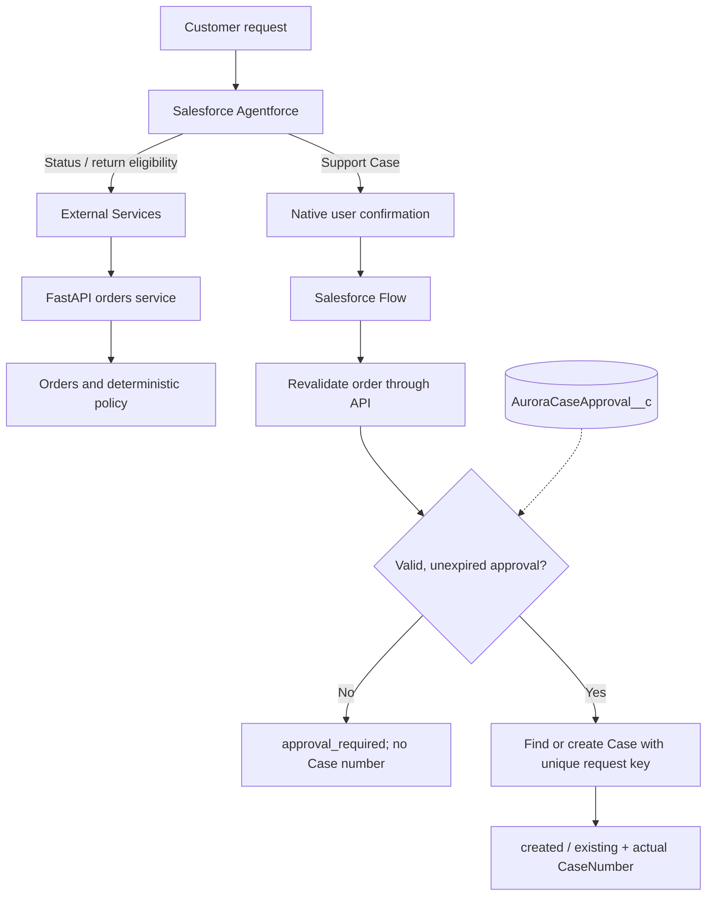

# Aurora After-Sales — an Agentforce engineering case study

[**Brazilian Portuguese**](readme.pt-BR.md) · [Salesforce setup and validation](salesforce/SETUP.md) · [MIT License](LICENSE)

**How much authority should a conversational AI agent have when it can read business data and create records?**

Aurora is a fictional online store used to explore that question with **Salesforce Agentforce**, **External Services**, a **Python/FastAPI orders API**, and a **Salesforce Flow**. The agent handles the conversation; deterministic code evaluates return eligibility; Salesforce enforces a separate authorization boundary before a support Case can be read or created.

**Status — November 2026:** a working, partially validated **Developer Edition demo**, not a production service or a publicly deployed customer-facing agent. All orders and customer references are synthetic.

## The scenario

| Customer question | System behavior | Decision authority |
| --- | --- | --- |
| “Where is order AUR-1003?” | Retrieve product and shipment status | Orders API |
| “Can I return order AUR-1002?” | Evaluate a **fictional 30-day return policy** and return an explanation and policy reference | Deterministic Python policy |
| “Open a support case for AUR-1003.” | Require native confirmation, revalidate the order, verify independent approval, then create or reuse a Case | Agentforce confirmation **and** Salesforce Flow |

The agent does **not** decide return exceptions, initiate refunds, accept arbitrary Case fields from chat, or grant itself permission to create Cases.

## Architecture and control boundaries



**The authorization boundary lives in the Flow, not in the prompt.** `AbrirCasoPosVenda` checks the order and a separately recorded, current `AuroraCaseApproval__c` approval **before querying even an existing Case**. A unique `Case.AuroraRequestKey__c` prevents duplicate records on retries. Approvals are administered outside the conversation; this demo does **not** implement a native Salesforce Approval Process or automated customer approval.

The Orders API uses `X-API-Key` with Salesforce Named/External Credentials. This authenticates the **Salesforce-to-API integration**, not the person talking to the agent.

## Verified results

These are **observations from specific Developer Edition tests**, not a complete security certification:

- The Agent Script validated with **zero errors**; actions were exercised through Agentforce Preview with `--use-live-actions`.
- Native confirmation was observed. A positive confirmation proceeded; cancellation did not execute the Case action in the tested session.
- A Case was created under the agent execution user. A repeat request returned **the existing CaseNumber** without creating a duplicate.
- After approval revocation, the Flow returned `approval_required` and an empty `case_number` **even though a Case already existed**. This regression fixed an earlier Case-number disclosure path.
- Object, field, group and record-access checks found no create/edit/delete grants on approval records for the agent user; inspected Case permissions allowed read/create, not edit/delete.
- Python unit/contract tests, a quality gate, and offline Salesforce metadata checks are in the repository. The **full 12-scenario Agentforce evaluation has not yet been run and reported as one suite**.

For implementation details and test commands, see [Salesforce setup and evidence](salesforce/SETUP.md) and [evaluation scenarios](evals/scenarios.json).

## Known limitation: customer identity is not verified

**The existing Agentforce actions do not yet authenticate the individual customer.** Their legacy API routes are limited to one fixed synthetic customer (`customer-demo-001`), not a verified person. In a real Agentforce preview, asking for `AUR-1003` revealed its product and `shipped` status without verifying who was asking.

The independent approval guard protects the Case path, but it **does not replace customer authentication** for status and return lookups. Neither a messaging/contact ID nor an LLM-supplied `customer_ref` should be trusted as proof of order ownership.

**Do not expose the agent as a public customer-support channel.** Making the source repository public does not mean the agent is safe for real customers.

### Next increment: signed customer context for backend reads (branch)

The Python API now also has two customer-scoped endpoints, `/verified/orders/{order_id}` and `/verified/orders/{order_id}/return-eligibility`. They require **both** the Salesforce-to-API `X-API-Key` and a short-lived `X-Aurora-Customer-Session` token. The server verifies an HMAC signature, audience, issuer, issue/expiry times and (if supplied to the app) a revocation set, then checks the signed customer reference against order ownership. Unknown orders and other customers' orders return the same 404 response. Caller-provided query parameters cannot override the signed identity.

**This is a backend authorization increment, not an end-to-end Salesforce authentication implementation.** The included token-minting script simulates a *trusted channel* for synthetic tests; it does not authenticate a human. No token issuance endpoint is exposed. In a real channel, a separate trusted identity/session provider must verify the customer and inject context outside the model's control, with key custody and durable revocation. Neither the existing Agentforce actions nor the Case Flow currently propagate this context. They still rely on the original fixed-customer integration and must not be described as secure customer-facing workflows.

For fail-closed defaults, the two legacy `/orders/...` routes now respond with 403 unless `AURORA_ENABLE_UNVERIFIED_DEMO_READS=1` is explicitly set. That opt-in is **only for an isolated, fictional demonstration** and is not a security control. The new verified routes respond with 503 when `AURORA_CUSTOMER_SESSION_SECRET` is absent.

**Local verified-read example** (use different secrets; never commit them):

```bash
export AURORA_API_KEY="$(python3 -c 'import secrets; print(secrets.token_urlsafe(32))')"
export AURORA_CUSTOMER_SESSION_SECRET="$(python3 -c 'import secrets; print(secrets.token_urlsafe(32))')"
uv run uvicorn aurora_orders.entrypoints.api:create_app --factory --host 127.0.0.1 --port 8000
```

In a second terminal with the same two variables, generate an *artificial* test session:

```bash
CUSTOMER_SESSION="$(uv run python scripts/mint_demo_session.py --customer customer-demo-001)"
curl -H "X-API-Key: $AURORA_API_KEY" \
     -H "X-Aurora-Customer-Session: $CUSTOMER_SESSION" \
     http://127.0.0.1:8000/verified/orders/AUR-1001
```

Tokens expire after five minutes. This is not a login flow. In-memory revocation injection is for tests, not a distributed session store. Do not forward the token through a chat message or an LLM-generated tool argument.

### Phase 2: ownership evidence for Case authorization

The verified API now also provides `/verified/orders/{order_id}/case-authorization`, returning a server-derived customer-scoped request key after ownership validation. It does not approve or create Cases. See the [verified contract and Salesforce cutover checklist](salesforce/VERIFIED-INTEGRATION.md). Existing Salesforce metadata remains legacy and has not been migrated.

## Run the orders API locally

Requirements: **Python 3.14** and [uv](https://docs.astral.sh/uv/).

```bash
uv sync --frozen --all-groups
export AURORA_API_KEY="$(python3 -c 'import secrets; print(secrets.token_urlsafe(32))')"
export AURORA_ENABLE_UNVERIFIED_DEMO_READS=1  # isolated legacy Salesforce demo ONLY
uv run uvicorn aurora_orders.entrypoints.api:create_app --factory --host 127.0.0.1 --port 8000
```

In another terminal, with the **same** `AURORA_API_KEY` configured:

```bash
curl -H "X-API-Key: $AURORA_API_KEY" http://127.0.0.1:8000/orders/AUR-1001
curl -H "X-API-Key: $AURORA_API_KEY" http://127.0.0.1:8000/orders/AUR-1001/return-eligibility
```

Run the Python quality gate using `uv run python scripts/quality_gate.py`. Salesforce setup also needs manual credentials and a reachable HTTPS endpoint. Integration testing used a **temporary Cloudflare Quick Tunnel**, not permanent hosting. Follow [salesforce/SETUP.md](salesforce/SETUP.md) for org configuration and live-action cautions.

## Explore the implementation

| Component | Source |
| --- | --- |
| Agent instructions and actions | [Agent Script](salesforce/force-app/main/default/aiAuthoringBundles/Aurora_Pos_Venda_1/Aurora_Pos_Venda_1.agent) |
| Authorization and Case idempotency | [Salesforce Flow](salesforce/force-app/main/default/flows/AbrirCasoPosVenda.flow-meta.xml) |
| Orders API and business policy | [Python source](src/aurora_orders/) |
| Integration contract | [OpenAPI 3.0.3](salesforce/openapi.json) |
| Tests and evaluation plan | [Python tests](tests/) · [Agentforce scenarios](evals/scenarios.json) |
| Salesforce instructions / tooling | [Setup guide](salesforce/SETUP.md) · [DX scripts](scripts/) |

## What's next

1. Integrate a **trusted customer identity provider** with Agentforce actions and the Case Flow; pass signed context outside LLM control and switch Salesforce reads to the verified endpoints.
2. Bind approvals and idempotency keys to verified identity instead of `customer-demo-001`.
3. Validate repeatable setup in a clean Salesforce org without committing secrets or relying on a temporary tunnel.
4. Execute and report all **12 evaluation scenarios**, strengthen adversarial tests, and record a reproducible demo.

Aurora selectively adapts the author's [Python engineering harness](https://github.com/brunovicco/codex-python-engineering-harness/tree/e9e297456573d216f070a41a7cdaa108dd599c5b). The return policy is fictional, not legal advice or an actual commercial policy.

**License:** [MIT](LICENSE).

### Trusted channel reference

The [trusted channel resolver](salesforce/TRUSTED-CHANNEL.md) validates pre-authenticated conversation bindings outside the model and injects signed context through an allowlisted reference transport. It is a Python reference boundary, not a deployed Salesforce adapter.

The internal Apex callout client is available as an isolated candidate in the [trusted channel guide](salesforce/TRUSTED-CHANNEL.md); it is not exposed as an agent action or validated in an org.

The internal Apex context facade re-resolves a trusted binding on every operation; no production binding resolver or invocable action is installed.

A concrete internal Apex broker client is available as a candidate; the authenticated broker service and runtime binding are not implemented.

An opt-in Python broker reference now supports pre-authenticated registration, resolution and revocation. It is process-local and not a production identity provider.
