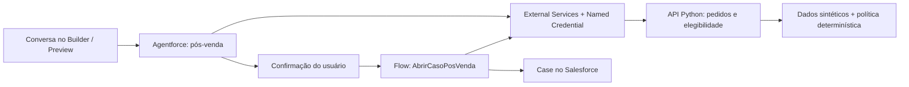

# Aurora — agente de pós-venda com Salesforce Agentforce

Um agente consulta pedidos, explica a elegibilidade para devolução e, após confirmação,
abre um caso no Salesforce. O objetivo do portfólio é demonstrar ações úteis, integração
segura, regras verificáveis e avaliação do agente.

**Estado:** API Python e contrato de integração implementados localmente. O agente, o Flow
e os testes de conversa ainda precisam ser configurados e executados em uma Developer Edition.
A integração ainda não foi validada de ponta a ponta na Salesforce e a API não foi
implantada em um serviço de hospedagem.

## Escopo e arquitetura



| Ação | Responsabilidade | Evidência para o portfólio |
| --- | --- | --- |
| `getOrder` | Consultar status de pedido autorizado | Integração externa e respostas baseadas em dados |
| `checkReturnEligibility` | Aplicar política e devolver motivo + versão | Separação entre linguagem natural e decisão de negócio |
| `AbrirCasoPosVenda` | Criar ou recuperar caso após confirmação | Flow, permissões, tratamento de falhas e repetição segura |

O Agentforce interpreta a conversa e escolhe ações. Python representa o sistema externo
de pedidos e executa as regras de devolução. A criação de casos pertence ao Salesforce.
O MVP usa um agente, um subagente/tópico de pós-venda, duas leituras externas e um Flow.

A política de 30 dias é **fictícia**, criada para os testes; não representa uma política
comercial real nem uma interpretação de legislação. A elegibilidade não efetua devolução
ou reembolso. Pedidos entregues há até 30 dias, inclusive, são aceitos se o item for elegível.
Pedidos não entregues, itens excluídos e datas inconsistentes são recusados com motivo.

## Começar localmente

Requisitos: Python 3.14 e uv. No diretório deste projeto:

```bash
uv sync --frozen --all-groups
export AURORA_API_KEY="$(python3 -c 'import secrets; print(secrets.token_urlsafe(32))')"
uv run uvicorn aurora_orders.entrypoints.api:create_app --factory --host 127.0.0.1 --port 8000
```

A chave fica apenas no ambiente local. A aplicação não carrega `.env` automaticamente
e recusa iniciar sem uma chave de pelo menos 32 caracteres. Em outro terminal com a mesma
variável definida, consulte:

```bash
curl -H "X-API-Key: $AURORA_API_KEY" http://127.0.0.1:8000/orders/AUR-1001
curl -H "X-API-Key: $AURORA_API_KEY" http://127.0.0.1:8000/orders/AUR-1001/return-eligibility
```

Swagger local: `http://127.0.0.1:8000/docs`. Para a Salesforce, importe
[`salesforce/openapi.json`](salesforce/openapi.json), um contrato OpenAPI 3.0.3 validado
pelos testes; não importe automaticamente o `/openapi.json` do FastAPI, que pode usar 3.1.
O guia [`salesforce/SETUP.md`](salesforce/SETUP.md) detalha a integração.

| Pedido | Cenário no início de cada execução |
| --- | --- |
| AUR-1001 | Entregue há 5 dias: elegível |
| AUR-1002 | Entregue há 31 dias: prazo expirado |
| AUR-1003 | Em transporte: não entregue |
| AUR-1004 | Entregue há 30 dias: limite aceito |
| AUR-1005 | Item personalizado: excluído |
| AUR-1006 | Cancelado: não entregue |
| AUR-9001 | Outro cliente: indisponível |

As datas são geradas na inicialização; a avaliação usa a data UTC de cada requisição.
A credencial desta demo é restrita no servidor a um único cliente fictício. O agente
não pode escolher esse cliente. Isso demonstra isolamento, mas não implementa login
de consumidores ou identidade por sessão. Um canal público real exigiria esse vínculo.

## Ambiente gratuito e limites

Use a [Developer Edition com Agentforce](https://developer.salesforce.com/docs/ai/agentforce/guide/agent-dx-set-up-env.html).
A documentação oficial permite dispensar Data 360 quando o agente não depende dele;
este MVP consulta os dados por ações. Verifique os limites efetivamente provisionados na
nova organização antes de testes em lote: ambiente gratuito não significa consumo ilimitado.
Limites do Agentforce Vibes, ferramenta de desenvolvimento, não são limites do agente em execução.

Python roda no computador. Para uma demonstração conectada, a Salesforce precisa de uma
URL HTTPS acessível; `localhost` não funciona como destino de callout na nuvem.
Um [Cloudflare Quick Tunnel](https://developers.cloudflare.com/tunnel/get-started/quick-tunnels/)
pode fornecer uma URL temporária sem conta ou domínio. A URL muda, depende do computador
ligado e é apropriada para testes. Nenhum túnel foi aberto por este projeto.

## Validação e roteiro de entrega

```bash
uv run python scripts/quality_gate.py
```

O gate executa validação do lockfile, Ruff, arquitetura, Mypy, pytest com cobertura,
Bandit e auditoria de dependências. Os testes cobrem regras de prazo, autenticação,
isolamento de pedidos, erros e compatibilidade das respostas com OpenAPI 3.0.
Esses testes **não avaliam o raciocínio do Agentforce**.

Verificação local em 05/11/2026: **48 testes aprovados, 100% de cobertura do pacote Python
e gate completo aprovado**. Bandit não identificou problemas e a auditoria não encontrou
vulnerabilidades conhecidas nas dependências publicadas. O pacote local não é auditável
no PyPI. A biblioteca de testes emitiu um aviso de depreciação de `httpx`, sem falha;
as versões verificadas estão fixadas em `uv.lock`. Essa evidência corresponde à execução
local; consulte o workflow no GitHub para o resultado da integração contínua.

1. **Fundação local:** API, fixtures, testes e contrato OpenAPI — implementados.
2. **Integração:** criar Developer Edition, configurar credenciais e registrar as duas ações.
3. **Ação de negócio:** criar o Flow e ativar confirmação antes da abertura do caso.
4. **Vitrine:** executar os [12 cenários](evals/scenarios.json), recuperar os metadados reais
   da org e gravar uma demonstração de 3–5 minutos.

Os cenários são um roteiro próprio, não um arquivo nativo do Testing Center. Registre
pass/fail, ação utilizada, resultado esperado/obtido e tempo observado. Metas iniciais:
12/12 cenários aceitos, zero exposição entre clientes, zero casos antes da confirmação
e nenhum caso duplicado em repetição. São metas, não resultados já medidos.
Use o [Testing Center / Testing API](https://developer.salesforce.com/docs/ai/agentforce/guide/testing-api.html)
ou Agentforce DX quando disponíveis na org; confirme as exigências e cotas antes do lote.

Na gravação, mostre uma consulta, uma devolução fora do prazo, uma tentativa de forçar
exceção e um caso criado somente após confirmação. Exiba também um teste de limite
e o motivo técnico da decisão. Isso fornece evidências de engenharia e de plataforma.

## Como o harness foi aproveitado

Base: [codex-python-engineering-harness](https://github.com/brunovicco/codex-python-engineering-harness/tree/e9e297456573d216f070a41a7cdaa108dd599c5b),
commit `e9e297456573d216f070a41a7cdaa108dd599c5b`, consultado em 05/11/2026.

Adaptação seletiva do perfil `service`: estrutura `src`, convenções de tipagem e testes,
configuração de ferramentas, gate único, validador de arquitetura e workflow de CI.
A licença MIT foi preservada. `quality_gate.py` foi adaptado para os recursos presentes;
o validador de arquitetura foi reaproveitado. Não é uma saída integral do bootstrap,
portanto `bootstrap.py --check` não é o verificador deste projeto.

As quatro pastas do pacote têm responsabilidades concretas e um módulo funcional cada.
O MVP dispensa banco, Redis, filas, Docker, Kubernetes, Terraform, orquestrador de agentes,
MCP, LangChain, Langfuse e modelos externos pagos. Também dispensa os documentos e controles
do harness voltados a funcionalidades que este projeto não utiliza.
Documentação explicativa: este README e o guia Salesforce. `AGENTS.md` contém apenas
instruções de manutenção; OpenAPI, cenários e testes são artefatos executáveis ou de avaliação.

Recursos Salesforce usados no desenho: [External Services como ações](https://help.salesforce.com/s/articleView?id=platform.external_services_custom_agent_actions.htm&language=en_US&type=5),
[credenciais de integração](https://help.salesforce.com/s/articleView?id=sf.external_services_define_named_credential.htm&language=en_US&type=5)
e [ações com confirmação](https://help.salesforce.com/s/articleView?id=ai.agent_actions_custom.htm&language=en_US&type=5).
As fontes descrevem capacidades; a disponibilidade e o comportamento desta integração
ainda precisam ser confirmados na organização criada para a demo.
