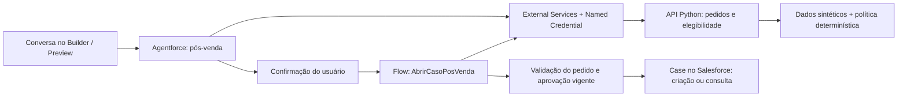

# Aurora — agente de pós-venda com Salesforce Agentforce

Um agente consulta pedidos, explica a elegibilidade para devolução e, após confirmação,
abre um caso no Salesforce. O objetivo do portfólio é demonstrar ações úteis, integração
segura, regras verificáveis e avaliação do agente.

**Estado em 21/11/2026 — marco parcial validado:** API Python, contrato OpenAPI,
External Service, Agent Script, Flow `AbrirCasoPosVenda`, objetos e permission sets
estão implementados e versionados. A integração com uma **Salesforce Developer Edition**
foi exercitada em previews com ações reais: consulta de pedido, confirmação nativa,
criação/recuperação de Case, proteção por aprovação e idempotência. A API foi exposta
temporariamente via Cloudflare Quick Tunnel para testes, **não está hospedada de forma
permanente**.

**Limite importante:** este é um laboratório com dados sintéticos, **não está pronto
para atendimento público ou produção**. A API autentica a integração por chave,
mas ainda não autentica cada cliente final. Um preview comprovou que é possível
consultar status e produto de `AUR-1003` sem identidade do consumidor verificada.
A correção desse controle está pendente.

## Escopo e arquitetura



| Ação | Responsabilidade | Evidência para o portfólio |
| --- | --- | --- |
| `getOrder` | Consultar status de pedido autorizado | Integração externa e respostas baseadas em dados |
| `checkReturnEligibility` | Aplicar política e devolver motivo + versão | Separação entre linguagem natural e decisão de negócio |
| `AbrirCasoPosVenda` | Criar ou recuperar caso após confirmação | Flow, permissões, tratamento de falhas e repetição segura |

O Agentforce interpreta a conversa e escolhe ações. Python representa o sistema externo
de pedidos e executa as regras de devolução. A criação de casos pertence ao Salesforce.
O MVP usa um agente, um subagente/tópico de pós-venda, duas leituras externas e um Flow.

A política de 30 dias é **fictícia**, criada para os testes; não representa uma política
comercial real nem uma interpretação de legislação. A elegibilidade não efetua devolução
ou reembolso. Pedidos entregues há até 30 dias, inclusive, são aceitos se o item for elegível.
Pedidos não entregues, itens excluídos e datas inconsistentes são recusados com motivo.

## Começar localmente

Requisitos: Python 3.14 e uv. No diretório deste projeto:

```bash
uv sync --frozen --all-groups
export AURORA_API_KEY="$(python3 -c 'import secrets; print(secrets.token_urlsafe(32))')"
uv run uvicorn aurora_orders.entrypoints.api:create_app --factory --host 127.0.0.1 --port 8000
```

A chave fica apenas no ambiente local. A aplicação não carrega `.env` automaticamente
e recusa iniciar sem uma chave de pelo menos 32 caracteres. Em outro terminal com a mesma
variável definida, consulte:

```bash
curl -H "X-API-Key: $AURORA_API_KEY" http://127.0.0.1:8000/orders/AUR-1001
curl -H "X-API-Key: $AURORA_API_KEY" http://127.0.0.1:8000/orders/AUR-1001/return-eligibility
```

Swagger local: `http://127.0.0.1:8000/docs`. Para a Salesforce, importe
[`salesforce/openapi.json`](salesforce/openapi.json), um contrato OpenAPI 3.0.3 validado
pelos testes; não importe automaticamente o `/openapi.json` do FastAPI, que pode usar 3.1.
O guia [`salesforce/SETUP.md`](salesforce/SETUP.md) detalha a integração.

| Pedido | Cenário no início de cada execução |
| --- | --- |
| AUR-1001 | Entregue há 5 dias: elegível |
| AUR-1002 | Entregue há 31 dias: prazo expirado |
| AUR-1003 | Em transporte: não entregue |
| AUR-1004 | Entregue há 30 dias: limite aceito |
| AUR-1005 | Item personalizado: excluído |
| AUR-1006 | Cancelado: não entregue |
| AUR-9001 | Outro cliente: indisponível |

As datas são geradas na inicialização; a avaliação usa a data UTC de cada requisição.
A credencial desta demo é restrita no servidor a um único cliente fictício. O agente
não pode escolher esse cliente. Isso demonstra isolamento, mas não implementa login
de consumidores ou identidade por sessão. Um canal público real exigiria esse vínculo.

## Ambiente gratuito e limites

Use a [Developer Edition com Agentforce](https://developer.salesforce.com/docs/ai/agentforce/guide/agent-dx-set-up-env.html).
A documentação oficial permite dispensar Data 360 quando o agente não depende dele;
este MVP consulta os dados por ações. Verifique os limites efetivamente provisionados na
nova organização antes de testes em lote: ambiente gratuito não significa consumo ilimitado.
Limites do Agentforce Vibes, ferramenta de desenvolvimento, não são limites do agente em execução.

Python roda no computador. Para uma demonstração conectada, a Salesforce precisa de uma
URL HTTPS acessível; `localhost` não funciona como destino de callout na nuvem.
Um [Cloudflare Quick Tunnel](https://developers.cloudflare.com/tunnel/get-started/quick-tunnels/)
pode fornecer uma URL temporária sem conta ou domínio. A URL muda, depende do computador
ligado e é apropriada para testes. **Esse túnel temporário foi usado nos testes de
integração**, mas não faz parte de uma hospedagem permanente nem disponibiliza um
endpoint estável para visitantes do repositório.

## Validação e roteiro de entrega

```bash
uv run python scripts/quality_gate.py
```

O gate executa validação do lockfile, Ruff, arquitetura, Mypy, pytest com cobertura,
Bandit e auditoria de dependências. Os testes cobrem regras de prazo, autenticação,
isolamento de pedidos, erros e compatibilidade das respostas com OpenAPI 3.0.
Esses testes **não avaliam o raciocínio do Agentforce**.

Verificação local em 05/11/2026: **48 testes aprovados, 100% de cobertura do pacote Python
e gate completo aprovado**. Bandit não identificou problemas e a auditoria não encontrou
vulnerabilidades conhecidas nas dependências publicadas. O pacote local não é auditável
no PyPI. A biblioteca de testes emitiu um aviso de depreciação de `httpx`, sem falha;
as versões verificadas estão fixadas em `uv.lock`. Essa evidência corresponde à execução
local; consulte o workflow no GitHub para o resultado da integração contínua.

### Entregue e verificado na Developer Edition

- **Fundação:** API FastAPI, dados sintéticos, política determinística de devolução,
  isolamento do cliente de demonstração na API, testes e OpenAPI 3.0.3.
- **Integração:** External Service `AuroraOrdersService`, Named/External Credential
  configuradas na org e ações `Get_Order` / `Check_Return_Eligibility`.
  As credenciais e seus valores secretos **não são versionados**.
- **Agentforce:** bundle `Aurora_Pos_Venda_1` com confirmação nativa da ação de escrita.
  Validação do bundle concluída com **zero erros**.
- **Salesforce Flow:** `AbrirCasoPosVenda` valida novamente o pedido,
  exige registro válido em `AuroraCaseApproval__c` **antes de consultar ou criar
  Cases**, usa `Case.AuroraRequestKey__c` único para idempotência e devolve
  `created`, `existing`, `approval_required`, `unavailable` ou `failed`.
  A aprovação é um **registro personalizado criado fora da conversa**; não há
  um Salesforce Approval Process formal nem um canal de aprovação automatizado.
- **Evidências reais:** confirmação positiva e cancelamento; bloqueio sem aprovação,
  aprovações revogadas ou expiradas; Case criado pelo usuário de execução do agente;
  consulta posterior do mesmo Case sem duplicação; regressão que impede divulgar
  um Case existente quando a aprovação é revogada. O retorno `approval_required`
  foi verificado no trace com `case_number` vazio.
- **Permissões críticas:** revisão de Permission Sets, componentes do Permission Set
  Group e `UserRecordAccess`: leitura de `AuroraCaseApproval__c` sem criar,
  editar ou excluir; leitura/criação de `Case` sem editar ou excluir.
  Não foram encontradas concessões `View All Data` ou `Modify All Data`
  nos conjuntos examinados. Isso não substitui auditoria de segurança exaustiva.

### Pendente / limitações conhecidas

1. **Prioridade de segurança:** autenticar o consumidor e associar identidade
   verificada a cada pedido, ação de leitura, aprovação e Case; aplicar a
   autorização no backend/Flow, não apenas por instrução ao LLM. Hoje a API
   opera com `customer-demo-001` fixo e o acesso de leitura **não exige
   autenticação do cliente final**.
2. Implementar mecanismo confiável de verificação de identidade (por exemplo,
   sessão autenticada ou OTP com verificação no backend). **OTP ainda não existe.**
3. Tornar o provisionamento reprodutível em outra org, incluindo configuração
   manual segura de credenciais, dependências e URLs; o Cloudflare Quick Tunnel
   é temporário. Revisar os scripts de deploy/retrieve/validação e CI localmente
   antes de versioná-los.
4. Executar e registrar formalmente os **[12 cenários](evals/scenarios.json)**
   como uma suíte completa, com evidências e métricas. Foram feitos testes
   manuais específicos no CLI, mas **não há evidência de 12/12** nem de
   uma execução integral do Testing Center.
5. Gravar demonstração reproduzível, documentar resultados finais e expandir
   testes adversariais, limites de taxa, expiração e observabilidade.

Os cenários são um roteiro próprio, não um arquivo nativo do Testing Center.
Metas futuras: 12/12 cenários aceitos, nenhuma exposição de dados entre
clientes verificados, zero Cases antes da confirmação e nenhum Case duplicado.
Use o [Testing Center / Testing API](https://developer.salesforce.com/docs/ai/agentforce/guide/testing-api.html)
ou Agentforce DX quando disponíveis na org; confirme as exigências e cotas antes do lote.

Na gravação, mostre uma consulta, uma devolução fora do prazo, uma tentativa de forçar
exceção e um caso criado somente após confirmação. Exiba também um teste de limite
e o motivo técnico da decisão. Isso fornece evidências de engenharia e de plataforma.

## Como o harness foi aproveitado

Base: [codex-python-engineering-harness](https://github.com/brunovicco/codex-python-engineering-harness/tree/e9e297456573d216f070a41a7cdaa108dd599c5b),
commit `e9e297456573d216f070a41a7cdaa108dd599c5b`, consultado em 05/11/2026.

Adaptação seletiva do perfil `service`: estrutura `src`, convenções de tipagem e testes,
configuração de ferramentas, gate único, validador de arquitetura e workflow de CI.
A licença MIT foi preservada. `quality_gate.py` foi adaptado para os recursos presentes;
o validador de arquitetura foi reaproveitado. Não é uma saída integral do bootstrap,
portanto `bootstrap.py --check` não é o verificador deste projeto.

As quatro pastas do pacote têm responsabilidades concretas e um módulo funcional cada.
O MVP dispensa banco, Redis, filas, Docker, Kubernetes, Terraform, orquestrador de agentes,
MCP, LangChain, Langfuse e modelos externos pagos. Também dispensa os documentos e controles
do harness voltados a funcionalidades que este projeto não utiliza.
Documentação explicativa: este README e o guia Salesforce. `AGENTS.md` contém apenas
instruções de manutenção; OpenAPI, cenários e testes são artefatos executáveis ou de avaliação.

Recursos Salesforce usados no desenho: [External Services como ações](https://help.salesforce.com/s/articleView?id=platform.external_services_custom_agent_actions.htm&language=en_US&type=5),
[credenciais de integração](https://help.salesforce.com/s/articleView?id=sf.external_services_define_named_credential.htm&language=en_US&type=5)
e [ações com confirmação](https://help.salesforce.com/s/articleView?id=ai.agent_actions_custom.htm&language=en_US&type=5).
As fontes descrevem capacidades gerais; **parte delas foi comprovada nesta demo**
por meio de validação e preview com ações reais. Para reproduzir a organização,
consulte [salesforce/SETUP.md](salesforce/SETUP.md). A configuração de credenciais
e a identidade de clientes permanecem específicas do ambiente e exigem tratamento separado.
