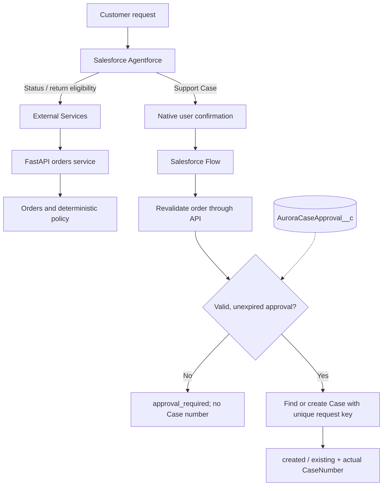

# Aurora After-Sales — an Agentforce engineering case study

[**Brazilian Portuguese**](readme.pt-BR.md) · [Salesforce setup and validation](salesforce/SETUP.md) · [MIT License](LICENSE)

**How much authority should a conversational AI agent have when it can read business data and create records?**

Aurora is a fictional online store used to explore that question with **Salesforce Agentforce**, **External Services**, a **Python/FastAPI orders API**, and a **Salesforce Flow**. The agent handles the conversation; deterministic code evaluates return eligibility; Salesforce enforces a separate authorization boundary before a support Case can be read or created.

**Status — November 2026:** a working, partially validated **Developer Edition demo**, not a production service or a publicly deployed customer-facing agent. All orders and customer references are synthetic.

## The scenario

| Customer question | System behavior | Decision authority |
| --- | --- | --- |
| “Where is order AUR-1003?” | Retrieve product and shipment status | Orders API |
| “Can I return order AUR-1002?” | Evaluate a **fictional 30-day return policy** and return an explanation and policy reference | Deterministic Python policy |
| “Open a support case for AUR-1003.” | Require native confirmation, revalidate the order, verify independent approval, then create or reuse a Case | Agentforce confirmation **and** Salesforce Flow |

The agent does **not** decide return exceptions, initiate refunds, accept arbitrary Case fields from chat, or grant itself permission to create Cases.

## Architecture and control boundaries



**The authorization boundary lives in the Flow, not in the prompt.** `AbrirCasoPosVenda` checks the order and a separately recorded, current `AuroraCaseApproval__c` approval **before querying even an existing Case**. A unique `Case.AuroraRequestKey__c` prevents duplicate records on retries. Approvals are administered outside the conversation; this demo does **not** implement a native Salesforce Approval Process or automated customer approval.

The Orders API uses `X-API-Key` with Salesforce Named/External Credentials. This authenticates the **Salesforce-to-API integration**, not the person talking to the agent.

## Verified results

These are **observations from specific Developer Edition tests**, not a complete security certification:

- The Agent Script validated with **zero errors**; actions were exercised through Agentforce Preview with `--use-live-actions`.
- Native confirmation was observed. A positive confirmation proceeded; cancellation did not execute the Case action in the tested session.
- A Case was created under the agent execution user. A repeat request returned **the existing CaseNumber** without creating a duplicate.
- After approval revocation, the Flow returned `approval_required` and an empty `case_number` **even though a Case already existed**. This regression fixed an earlier Case-number disclosure path.
- Object, field, group and record-access checks found no create/edit/delete grants on approval records for the agent user; inspected Case permissions allowed read/create, not edit/delete.
- Python unit/contract tests, a quality gate, and offline Salesforce metadata checks are in the repository. The **full 12-scenario Agentforce evaluation has not yet been run and reported as one suite**.

For implementation details and test commands, see [Salesforce setup and evidence](salesforce/SETUP.md) and [evaluation scenarios](evals/scenarios.json).

## Known limitation: customer identity is not verified

**Read actions do not yet authenticate the individual customer.** The demo API is restricted to one fixed synthetic customer (`customer-demo-001`). In a real Agentforce preview, asking for `AUR-1003` revealed its product and `shipped` status without verifying who was asking.

The independent approval guard protects the Case path, but it **does not replace customer authentication** for status and return lookups. Neither a messaging/contact ID nor an LLM-supplied `customer_ref` should be trusted as proof of order ownership.

**Do not expose the agent as a public customer-support channel.** Making the source repository public does not mean the agent is safe for real customers.

## Run the orders API locally

Requirements: **Python 3.14** and [uv](https://docs.astral.sh/uv/).

```bash
uv sync --frozen --all-groups
export AURORA_API_KEY="$(python3 -c 'import secrets; print(secrets.token_urlsafe(32))')"
uv run uvicorn aurora_orders.entrypoints.api:create_app --factory --host 127.0.0.1 --port 8000
```

In another terminal, with the **same** `AURORA_API_KEY` configured:

```bash
curl -H "X-API-Key: $AURORA_API_KEY" http://127.0.0.1:8000/orders/AUR-1001
curl -H "X-API-Key: $AURORA_API_KEY" http://127.0.0.1:8000/orders/AUR-1001/return-eligibility
```

Run the Python quality gate using `uv run python scripts/quality_gate.py`. Salesforce setup also needs manual credentials and a reachable HTTPS endpoint. Integration testing used a **temporary Cloudflare Quick Tunnel**, not permanent hosting. Follow [salesforce/SETUP.md](salesforce/SETUP.md) for org configuration and live-action cautions.

## Explore the implementation

| Component | Source |
| --- | --- |
| Agent instructions and actions | [Agent Script](salesforce/force-app/main/default/aiAuthoringBundles/Aurora_Pos_Venda_1/Aurora_Pos_Venda_1.agent) |
| Authorization and Case idempotency | [Salesforce Flow](salesforce/force-app/main/default/flows/AbrirCasoPosVenda.flow-meta.xml) |
| Orders API and business policy | [Python source](src/aurora_orders/) |
| Integration contract | [OpenAPI 3.0.3](salesforce/openapi.json) |
| Tests and evaluation plan | [Python tests](tests/) · [Agentforce scenarios](evals/scenarios.json) |
| Salesforce instructions / tooling | [Setup guide](salesforce/SETUP.md) · [DX scripts](scripts/) |

## What's next

1. Authenticate the **real customer** and enforce customer-to-order authorization in both read actions and the Case Flow.
2. Bind approvals and idempotency keys to verified identity instead of `customer-demo-001`.
3. Validate repeatable setup in a clean Salesforce org without committing secrets or relying on a temporary tunnel.
4. Execute and report all **12 evaluation scenarios**, strengthen adversarial tests, and record a reproducible demo.

Aurora selectively adapts the author's [Python engineering harness](https://github.com/brunovicco/codex-python-engineering-harness/tree/e9e297456573d216f070a41a7cdaa108dd599c5b). The return policy is fictional, not legal advice or an actual commercial policy.

**License:** [MIT](LICENSE).
