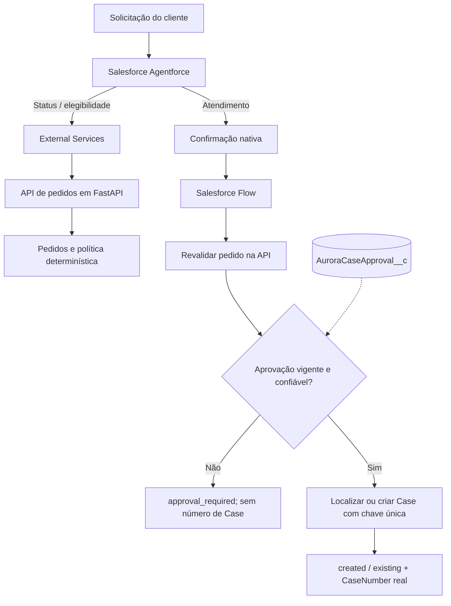

# Aurora After-Sales — estudo de caso de engenharia com Agentforce

[**English — principal**](README.md) · [Configuração e validação Salesforce](salesforce/SETUP.md) · [Licença MIT](LICENSE)

**Até onde deve ir a autoridade de um agente conversacional capaz de consultar dados de negócio e criar registros?**

O Aurora é uma loja virtual fictícia usada para explorar essa questão com **Salesforce Agentforce**, **External Services**, uma **API de pedidos em Python/FastAPI** e um **Salesforce Flow**. O agente conduz a conversa; regras determinísticas avaliam devoluções; o Salesforce aplica um controle separado de autorização antes de consultar ou criar um Case.

**Estado — novembro de 2026:** demonstração funcional, **parcialmente validada em uma Developer Edition**. Não é um serviço pronto para produção nem um agente disponível como canal público de atendimento. Todos os dados de pedidos e clientes são fictícios.

## O caso explorado

| Pergunta do cliente | Comportamento do sistema | Quem decide |
| --- | --- | --- |
| “Onde está o pedido AUR-1003?” | Consulta o produto e o status de entrega | API de pedidos |
| “Posso devolver o pedido AUR-1002?” | Avalia uma **política fictícia de 30 dias**, com explicação e referência da regra | Política determinística em Python |
| “Abra um atendimento para AUR-1003.” | Exige confirmação nativa, revalida o pedido, verifica aprovação independente e cria ou reutiliza um Case | Confirmação no Agentforce **e** Salesforce Flow |

O agente **não** decide exceções de devolução, efetua reembolsos, aceita campos arbitrários de Case informados no chat nem concede a si mesmo permissão de criação.

## Arquitetura e limites de autoridade



**O controle de autorização fica no Flow, não no prompt.** O `AbrirCasoPosVenda` verifica o pedido e uma aprovação `AuroraCaseApproval__c` registrada separadamente e dentro do prazo **antes mesmo de consultar um Case existente**. O campo único `Case.AuroraRequestKey__c` impede duplicações nas repetições. As aprovações são administradas fora da conversa; **não** implementamos um Salesforce Approval Process nativo nem aprovação automatizada pelo consumidor.

A API usa `X-API-Key` com Named/External Credentials do Salesforce. Essa chave autentica **a integração Salesforce–API**, não a pessoa conversando com o agente.

## O que já foi comprovado

São **resultados de testes específicos na Developer Edition**, não uma certificação completa de segurança:

- O Agent Script foi validado com **zero erros**, e as ações foram executadas pelo Agentforce Preview com `--use-live-actions`.
- A confirmação nativa foi observada. A confirmação positiva prosseguiu; o cancelamento não executou a ação de Case na sessão testada.
- Um Case real foi criado pelo usuário de execução do agente. Ao repetir o pedido, o mesmo **CaseNumber** foi devolvido, sem duplicação.
- Com a aprovação revogada, o Flow retornou `approval_required` e `case_number` vazio **mesmo com um Case já existente**. Esse teste de regressão corrigiu uma possibilidade anterior de exposição do número de atendimento.
- A verificação de permissões de objeto, campo, grupos e registros não encontrou concessões de criação/edição/exclusão de aprovações ao agente. Nos controles examinados, Case permitia leitura/criação, mas não edição/exclusão.
- O repositório contém testes Python, quality gate e verificações estáticas de metadados Salesforce. **A suíte completa dos 12 cenários Agentforce ainda não foi executada e relatada como conjunto.**

Detalhes, comandos e evidências no [guia Salesforce](salesforce/SETUP.md) e nos [cenários de avaliação](evals/scenarios.json).

## Limitação conhecida: falta autenticar o consumidor

**As ações de leitura existentes no Agentforce ainda não verificam a identidade individual do cliente.** As rotas legadas da API utilizam o cliente fictício fixo `customer-demo-001`. Em um preview real, informar o pedido `AUR-1003` permitiu consultar produto e status `shipped` sem confirmar quem estava solicitando.

O controle de aprovação protege o caminho de Cases, mas **não substitui autenticação** para consultas de status e devolução. Um ID de sessão/contato ou um `customer_ref` fornecido pelo LLM também não prova a propriedade do pedido.

**Não exponha esse agente como canal público de atendimento.** A publicação do repositório disponibiliza o código, não um serviço seguro para clientes reais.

### Camada de autorização por cliente na API

As rotas `/verified/orders/{order_id}` e `/verified/orders/{order_id}/return-eligibility` exigem **duas credenciais independentes**: `X-API-Key` para a integração e `X-Aurora-Customer-Session` para o contexto individual. O backend valida assinatura HMAC, emissor, destinatário, validade temporal e revogação quando fornecida, então compara a identidade assinada com o dono do pedido. Pedidos inexistentes e pertencentes a outro cliente têm a mesma resposta 404. Um parâmetro ou mensagem do usuário não pode trocar a identidade assinada.

**Esse avanço protege as novas rotas da API; não conclui autenticação no Salesforce.** O script de emissão produz apenas sessões artificiais para testes, sem autenticar pessoas. Ainda é necessário integrar um canal confiável que identifique o consumidor e injete o contexto fora do controle do LLM, além de configurar a revogação persistente disponível no broker opcional. As ações Agentforce e o Flow atuais **não** propagam essa identidade.

As rotas legadas `/orders/...` ficam desabilitadas por padrão (403). Para reproduzir a demonstração existente, é preciso habilitar `AURORA_ENABLE_UNVERIFIED_DEMO_READS=1` **somente em laboratório isolado com dados fictícios**. As novas rotas retornam 503 caso `AURORA_CUSTOMER_SESSION_SECRET` não seja configurada.

Para testar a nova rota localmente, configure duas chaves distintas na sessão que inicia a API:

```bash
export AURORA_API_KEY="$(python3 -c 'import secrets; print(secrets.token_urlsafe(32))')"
export AURORA_CUSTOMER_SESSION_SECRET="$(python3 -c 'import secrets; print(secrets.token_urlsafe(32))')"
uv run uvicorn aurora_orders.entrypoints.api:create_app --factory --host 127.0.0.1 --port 8000
```

No segundo terminal, com as mesmas variáveis exportadas:

```bash
CUSTOMER_SESSION="$(uv run python scripts/mint_demo_session.py --customer customer-demo-001)"
curl -H "X-API-Key: $AURORA_API_KEY" \
     -H "X-Aurora-Customer-Session: $CUSTOMER_SESSION" \
     http://127.0.0.1:8000/verified/orders/AUR-1001
```

Os tokens expiram em cinco minutos; a emissão local não é fluxo de login. Não enviar tokens no chat nem como parâmetros controlados pelo agente. O conjunto de revogação injetável é apenas para testes, não um armazenamento distribuído.

### Fase 2: evidência de titularidade para Cases

A rota `/verified/orders/{order_id}/case-authorization` devolve uma chave de solicitação derivada no servidor após verificar o vínculo com o cliente. Não aprova nem cria Cases. Consulte o [contrato e checklist de migração Salesforce](salesforce/VERIFIED-INTEGRATION.md). Os metadados existentes continuam legados e não foram migrados.

## Executar a API de pedidos localmente

Requisitos: **Python 3.14** e [uv](https://docs.astral.sh/uv/).

```bash
uv sync --frozen --all-groups
export AURORA_API_KEY="$(python3 -c 'import secrets; print(secrets.token_urlsafe(32))')"
export AURORA_ENABLE_UNVERIFIED_DEMO_READS=1  # somente demo legado isolado
uv run uvicorn aurora_orders.entrypoints.api:create_app --factory --host 127.0.0.1 --port 8000
```

Em outro terminal, com a **mesma** variável `AURORA_API_KEY` configurada:

```bash
curl -H "X-API-Key: $AURORA_API_KEY" http://127.0.0.1:8000/orders/AUR-1001
curl -H "X-API-Key: $AURORA_API_KEY" http://127.0.0.1:8000/orders/AUR-1001/return-eligibility
```

Execute o quality gate Python com `uv run python scripts/quality_gate.py`. A integração Salesforce exige credenciais configuradas manualmente na org e um endpoint HTTPS acessível. Os testes utilizaram um **Cloudflare Quick Tunnel temporário**, não uma hospedagem permanente. Consulte [salesforce/SETUP.md](salesforce/SETUP.md) para configuração e cuidados com ações reais.

## Onde está cada componente

| Componente | Local |
| --- | --- |
| Instruções e ações do agente | [Agent Script](salesforce/force-app/main/default/aiAuthoringBundles/Aurora_Pos_Venda_1/Aurora_Pos_Venda_1.agent) |
| Autorização e idempotência de Cases | [Salesforce Flow](salesforce/force-app/main/default/flows/AbrirCasoPosVenda.flow-meta.xml) |
| API e política determinística | [Código Python](src/aurora_orders/) |
| Contrato de integração | [OpenAPI 3.0.3](salesforce/openapi.json) |
| Testes e roteiro de avaliação | [Testes Python](tests/) · [Cenários Agentforce](evals/scenarios.json) |
| Instruções Salesforce / ferramentas DX | [Guia de configuração](salesforce/SETUP.md) · [Scripts](scripts/) |

## Próximos passos

1. Integrar um **provedor confiável de identidade** às ações Agentforce e ao Flow, com contexto assinado fora do controle do LLM; migrar as consultas para as rotas verificadas.
2. Vincular as aprovações e as chaves de idempotência à identidade verificada, substituindo `customer-demo-001`.
3. Validar implantação reproduzível em uma org limpa, sem versionar credenciais nem depender de túnel temporário.
4. Executar e documentar os **12 cenários de avaliação**, ampliar os testes adversariais e gravar uma demonstração reproduzível.

O projeto adapta seletivamente o [harness Python do autor](https://github.com/brunovicco/codex-python-engineering-harness/tree/e9e297456573d216f070a41a7cdaa108dd599c5b). A política de devolução é fictícia; não representa orientação jurídica nem uma política comercial real.

**Licença:** [MIT](LICENSE).

### Referência de canal confiável

A [referência da fase 3](salesforce/TRUSTED-CHANNEL.md) inclui resolvedor e
transporte Python, broker privado opcional com política explícita de escopo,
armazenamento em memória ou SQLite, rate limiting local, auditoria mínima e
clientes Apex internos candidatos. Autenticação real do canal, vínculo de
execução Salesforce, configuração de credenciais e validação na org permanecem
pendentes. As ações Agentforce e o Flow existentes continuam inalterados.

### Ações verificadas candidatas

A [fachada de leitura da fase 4](salesforce/VERIFIED-ACTIONS.md) devolve apenas dados de negócio ou indisponibilidade genérica. Nenhuma ação Agentforce foi ativada.
